<p align="center">
  
</p>

<p align="center">


</p>

# 🗂️ Dossiê

> Transforma a análise de um caso jurídico em **provas, requisitos, cronologia, grafo e relatório**, mostrando de onde veio cada informação.

Criado por **[Lucas Barkoski](https://github.com/Barkoski)**.

**Navegue:** [🧭 O que é](#o-que-e) · [📌 O que entrega](#o-que-entrega) · [🚀 Instalação](#instalacao) · [💡 Como usar](#como-usar) · [🚧 Limites](#limites) · [📚 Documentação](#documentacao)

<p align="center">
  
</p>

<a id="o-que-e"></a>
## 🧭 O que é

O Dossiê é uma skill para Claude e Codex. Você analisa um caso com a IA e, depois, pede o dossiê. A skill organiza o que foi analisado em tabelas, linha do tempo, grafo e relatório. Cada informação mostra a fonte: documento e página. O que não tem fonte aparece destacado.

**Princípio:** o dossiê não cria conhecimento novo. Ele não inventa data, valor, página ou documento. Quando algo falta, ele mostra a falta.

### 👥 Para quem é

- Advogados que analisam casos com IA e querem um resultado que possam conferir.
- Quem precisa separar o que está provado do que só foi afirmado.
- Serve para processo administrativo e judicial.

<a id="o-que-entrega"></a>
## 📌 O que entrega

| Saída | O que mostra |
|---|---|
| Índice documental | Tipo de cada documento, onde começa e termina, resumo e grau de certeza da identificação |
| Triagem | Procedimento, assunto, questão central, controvérsias, palavras-chave e normas citadas nos autos |
| Tabela de provas | Documento, conteúdo concreto, data, titular, página, qualidade da leitura, o que prova e se precisa conferir |
| Quadro de requisitos | Situação de cada requisito, fatos que o sustentam, lacuna e risco |
| Cronologia | Evento, grau de comprovação, fonte e página |
| Grafo do caso | Partes, documentos, fatos, requisitos e teses, ligados só pelas relações afirmadas na análise |
| Relatório | Texto corrido, pronto para copiar ou imprimir |
| Pendências | Três blocos: sem fonte, pendente de leitura e confirmar antes de usar |

### Os quatro graus de cada fato

```
FATO COMPROVADO         documento identificado, com localização
ALEGACAO                alguém afirmou, sem documento que sustente
INFERENCIA              deduzido do conjunto, com registro da base
SEM FONTE NA CONVERSA   apareceu na análise, sem origem identificável
```

Um requisito só fica `COMPROVADO` se **todos** os fatos que o sustentam forem `FATO COMPROVADO`, em documento lido, legível e com página. Alegação, inferência ou conclusão jurídica impedem esse status, e o validador recusa o arquivo.

### O painel visual

Um único arquivo HTML, sem dependências externas. Abre com duplo clique e funciona offline.

- Abas de grafo, documentos, provas, requisitos, cronologia, pendências e relatório.
- Busca sem acentos, filtros e fichas com resumo e transcrição completa separados.
- Aviso quando a transcrição é parcial, sem origem ou ausente.
- Abre o PDF do seu computador dentro da ficha para conferir a página, sem enviar o arquivo.
- Conferências pessoais (responsável, data e observação) salvas no navegador, com backup exportável.
- Tema claro e escuro automático. Todo estado tem rótulo em texto, não só cor.

<a id="instalacao"></a>
## 🚀 Instalação

### Claude Code

```text
/plugin marketplace add Barkoski/dossie
/plugin install dossie@barkoski-skills
```

Para atualizar uma versão já instalada:

```text
/plugin marketplace update barkoski-skills
/plugin update dossie@barkoski-skills
/reload-plugins
```

**Sem marketplace:** baixe o repositório e copie a pasta `skills/dossie` para `~/.claude/skills/` (no Windows, `C:\Users\SEU_USUARIO\.claude\skills\`). Reinicie a sessão. O arquivo deve ficar em `.claude/skills/dossie/SKILL.md`.

### Codex

Copie a pasta `skills/dossie` para `~/.codex/skills/` (no Windows, `C:\Users\SEU_USUARIO\.codex\skills\`). Reinicie o Codex ou abra uma nova tarefa. O arquivo deve ficar em `.codex/skills/dossie/SKILL.md`. No Codex, chame com `$dossie` ou peça em linguagem natural.

### Claude Cowork

O Cowork instala um arquivo `.plugin`. Para criá-lo:

1. Baixe o repositório e selecione o **conteúdo** da pasta (`.claude-plugin`, `skills`, `README.md`, `LICENSE`), não a pasta que os contém.
2. Compacte e renomeie de `.zip` para `.plugin`. A pasta `.claude-plugin` precisa ficar na raiz do arquivo compactado.
3. Arraste o `.plugin` para uma conversa do Cowork e confirme.

A cada atualização, o GitHub Actions também gera esse pacote (`dossie-plugin-v2.1.0`) na aba **Actions** do repositório.

### ChatGPT

Cole o conteúdo de `skills/dossie/SKILL.md` e dos seis arquivos de `skills/dossie/references/` nas instruções de um GPT personalizado.

<a id="como-usar"></a>
## 💡 Como usar

1. Analise os documentos do caso normalmente, no ambiente que você usa.
2. Peça o dossiê: `/dossie` ou "organize esta análise como dossiê".
3. Confira a tabela de provas antes de usar o relatório.

Também é possível indicar os documentos diretamente, sem análise prévia. Nesse caso, a skill lê só os arquivos que você apontar.

### Comandos

```
/dossie                # dossiê completo
/dossie provas         # só a tabela de provas
/dossie documentos     # índice e classificação dos documentos
/dossie triagem        # classe, assunto e questões do caso
/dossie requisitos     # só o quadro requisito-prova-lacuna
/dossie linha          # só a cronologia
/dossie grafo          # só o grafo do caso
/dossie relatorio      # relatório em texto corrido
/dossie --md           # só Markdown, sem HTML
/dossie --html         # gerar o painel visual
/dossie salvar         # salvar em dossie.json
/dossie atualizar      # incorporar só o que é novo ou corrigido
/dossie explicar R1    # explicar um item e suas ligações
/dossie caminho D1 T1  # mostrar o caminho entre dois itens
/dossie contradicoes   # listar conflitos registrados
/dossie lacunas        # listar requisitos e leituras pendentes
```

### Administrativo e judicial

| | Administrativo | Judicial |
|---|---|---|
| Localização | página do PDF, ID do anexo | evento, ID do documento, folha |
| Requisito | requisito legal do benefício | requisito legal e pressuposto processual |
| Tese | tese do requerente, motivo do indeferimento | tese de cada parte, fundamento da decisão |

### Exemplos

Os exemplos são **inteiramente fictícios**. Este repositório não contém dado de caso real.

- [`examples/caso-ficticio.md`](examples/caso-ficticio.md), [`.json`](examples/caso-ficticio.json) e [`.html`](examples/caso-ficticio.html): caso pequeno em três formatos.
- [`examples/caso-ficticio-rural/`](examples/caso-ficticio-rural/README.md): caso rural grande, com [relatório](examples/caso-ficticio-rural/relatorio.md), JSON e painel interativo.

### Scripts opcionais

Precisam de **Python 3.9 ou superior**, sem bibliotecas externas.

```bash
# gerar o painel (não sobrescreve arquivo existente; use --overwrite para isso)
python skills/dossie/scripts/render_dashboard.py examples/caso-ficticio.json --output dossie-visual.html

# validar o JSON e o HTML
python skills/dossie/scripts/dossie_tool.py validate examples/caso-ficticio.json --html dossie-visual.html

# consultas
python skills/dossie/scripts/dossie_tool.py explain examples/caso-ficticio.json R1
python skills/dossie/scripts/dossie_tool.py path examples/caso-ficticio.json D1 T1
python skills/dossie/scripts/dossie_tool.py contradictions examples/caso-ficticio.json
python skills/dossie/scripts/dossie_tool.py gaps examples/caso-ficticio.json
python skills/dossie/scripts/dossie_tool.py documents examples/caso-ficticio.json
python skills/dossie/scripts/dossie_tool.py screening examples/caso-ficticio.json
```

Painéis HTML antigos podem ser convertidos com `skills/dossie/scripts/migrate_legacy_html.py`, que extrai os dados sem executar o arquivo.

<a id="limites"></a>
## 🚧 Limites

- **Só organiza o material indicado.** Usa a conversa ou os documentos que você apontar. Não pesquisa na internet nem acrescenta conhecimento externo.
- **Não confere por você.** Toda linha sai para conferência humana. A tabela é um roteiro de conferência, não um certificado de veracidade.
- **Não decide.** Organiza a análise; a conclusão é do advogado. Não estima chance de êxito.
- **Validar o JSON não valida os fatos.** O validador confere estrutura e regras, não a verdade do conteúdo.

### 🔐 Sigilo

- O dossiê gerado contém dados do caso. Trate o arquivo como sigiloso e não o publique.
- O painel funciona offline, mas isso não torna local a IA da conversa. O processamento depende da plataforma e da conta que você usa.
- As conferências ficam só no navegador onde foram feitas. Exporte um backup antes de limpar os dados ou trocar de computador. O PDF vinculado vale só durante a sessão e deve ser selecionado de novo ao reabrir o painel.

<a id="documentacao"></a>
## 📚 Documentação

- [Regras da skill](skills/dossie/SKILL.md)
- [Referências técnicas](skills/dossie/references/)
- [Exemplos](examples/)
- [Como contribuir](CONTRIBUTING.md) · [Segurança](SECURITY.md) · [Código de conduta](CODE_OF_CONDUCT.md)

O catálogo `barkoski-skills` traz também a skill [Advocacia Previdenciária Barkoski](https://github.com/Barkoski/advocacia-previdenciaria-barkoski), que analisa autos e processos do INSS. Ela pode ser usada antes do dossiê, mas não é obrigatória:

```text
/plugin install advocacia-previdenciaria-barkoski@barkoski-skills
```

<details>
<summary>Histórico de versões</summary>

- **2.1**: ficha documental com resumo e transcrição separados; aviso de transcrição parcial ou ausente; PDF local dentro da ficha; caso rural fictício completo.
- **2.0**: tema visual Vidro, com claro e escuro automáticos.
- **1.8 e 1.9**: novos layouts do painel: claro e escuro, menu lateral e indicadores no topo.
- **1.7.1**: regra estrita: requisito `COMPROVADO` só com `FATO COMPROVADO` documental.
- **1.6**: recuperação de cronologia, contradições, triagem e riscos; migração segura de HTML antigo.
- **1.5**: painel interativo, conferências pessoais, backup e vínculo com PDF local.
- **1.4**: índice documental, triagem e comandos `documents` e `screening`.
- **1.2**: estado persistente em `dossie.json`, atualização incremental, consultas e validador.
- **1.1**: origem da conversa separada da fonte probatória; conflitos preservados; proteção do HTML.

</details>

## 👤 Autor e licença

Criado por **Lucas Barkoski**, [github.com/Barkoski](https://github.com/Barkoski). Publicado no catálogo `barkoski-skills`.

Licença MIT, veja [LICENSE](LICENSE).
